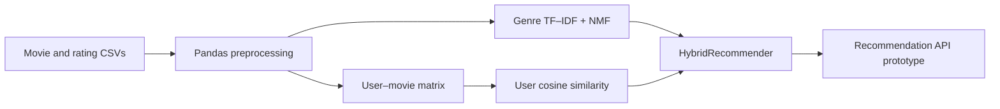

# Movie Recommendation Web App — Flask + Machine Learning

**A learning project exploring personalized recommendations through a Flask web application and scikit-learn.**

   

## Overview

This project explores a movie recommendation workflow that combines a Python web application with collaborative and content-derived recommendation signals.

**Technical areas covered**
- A Flask application factory and route blueprints
- Movie and rating data processing with Pandas
- User-based similarity via scikit-learn's cosine similarity
- TF–IDF features and non-negative matrix factorization (NMF) for movie genre metadata
- User login routes and a recommendation endpoint prototype

## How it is organized

| Path | Purpose |
| --- | --- |
| [`app.py`](app.py) | Application entry point |
| [`app/__init__.py`](app/__init__.py) | Flask factory, extensions, model initialization |
| [`app/routes.py`](app/routes.py) | Home, login, logout, and recommendation routes |
| [`app/utils.py`](app/utils.py) | Data ingestion, preprocessing, and NMF features |
| [`app/recommender.py`](app/recommender.py) | Collaborative and hybrid-recommendation prototype |
| [`data/`](data) | Movie, rating, and tagging datasets |
| [`tests/`](tests) | Early route-test prototypes |

## Recommendation approach



The implementation experiments with similarities between users and with latent movie metadata features. The current code should be treated as a **prototype**, not a validated recommendation-quality benchmark.

## Local development

The repository includes `requirements.txt` and a Flask entry point. A conventional development environment can be prepared with:

```bash
git clone https://github.com/venkatesh2022/mlrecommendation-app-flask.git
cd mlrecommendation-app-flask
python -m venv .venv
source .venv/bin/activate
pip install -r requirements.txt
python app.py
```

**Current status:** the application has known integration issues and may not start successfully without fixes. In particular, the code imports `flask_sqlalchemy` and `flask_cors` although those packages are not listed in `requirements.txt`; the recommender's user IDs and movie-factor indices also need review. The included tests reference an outdated application import. These commands describe intended development setup rather than a verified successful run.

## Improvements to complete before deployment

- Consolidate the SQLAlchemy model instance and configure the application's secret key through the environment
- Align required Python packages and replace the commented-out Dockerfile with a tested container build
- Verify user ID and movie index alignment in the hybrid recommendation logic
- Add deterministic unit tests for feature generation, recommendation scores, routes, and authentication
- Measure recommendation relevance on a held-out ratings split before publishing quality metrics

## Why this project matters

This repository demonstrates work at the intersection of **Python backend development and machine learning experimentation**, including web routes, feature processing, recommendation algorithms, and authentication concepts.

---

**[Venkatesh Thota](https://github.com/venkatesh2022)** · [Browse more projects](https://github.com/venkatesh2022?tab=repositories)
